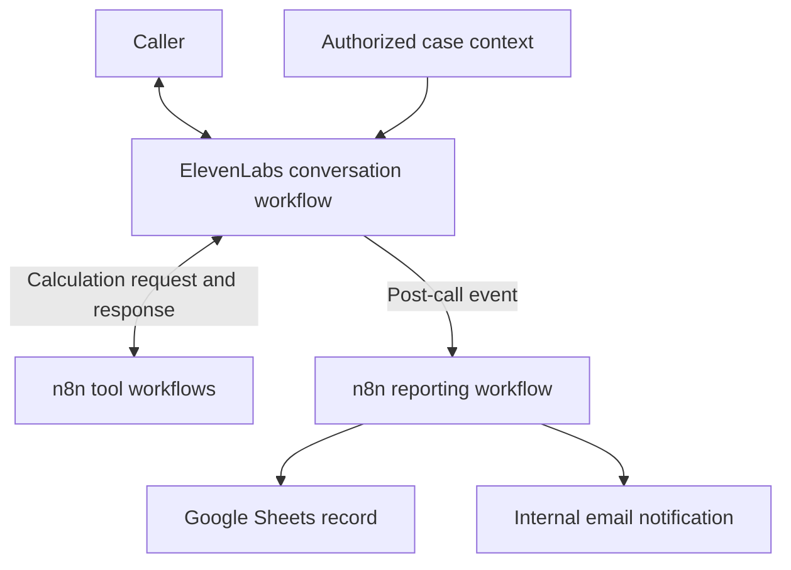
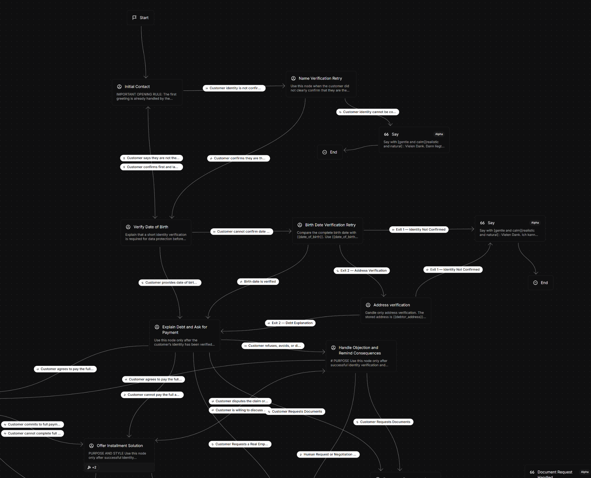

<h1 align="center"> AI Voice Agent for Payment Resolution</h1>

<p align="center">
  <strong>ElevenLabs conversation workflows · n8n automation · external calculation tools</strong><br>
  A technical portfolio of a German-language voice agent for sensitive payment conversations.
</p>

<p align="center">
  <a href="#the-project">Project</a> ·
  <a href="#architecture">Architecture</a> ·
  <a href="#inside-the-conversation">Conversation design</a> ·
  <a href="#automation-layer">Automation</a> ·
  <a href="#explore-the-repository">Explore</a>
</p>

> **Public portfolio edition.** This repository explains selected engineering decisions. It includes newly authored, inactive n8n scaffolds and synthetic examples. The complete production agent, instruction sets, business policies and node implementations remain private. The project screenshot includes the short previews visible in the editor.

## The project

I built this system to handle structured payment conversations while keeping confidential case information, calculation tools and operational follow-up within clearly defined boundaries.

The interesting engineering problem is maintaining a useful conversation across changing situations: an unclear identity, a question about a case, a payment proposal, a document request, or a request to speak with an employee. Each situation needs an appropriate next step, and the conversation must retain what has already been established.

The source project combines a German-language ElevenLabs agent, a branching conversation workflow, two installment-related n8n tool workflows, and post-call reporting through Google Sheets and email. This public edition shows how those responsibilities fit together.

## What the agent is designed to handle

| Capability | Purpose |
| --- | --- |
| Identity-aware conversation | Keep confidential case details behind an identity verification stage. |
| Contextual case explanation | Answer relevant questions using supplied case information and avoid inventing missing facts. |
| Full-payment discussion | Distinguish a payment intention from a concrete commitment. |
| Installment discussion | Support both a proposed installment count and a proposed monthly amount through external tools. |
| Objection handling | Respond to the actual question while staying within approved authority. |
| Employee review and callback | Preserve the reason for review without promising a live transfer or an unsupported callback time. |
| Document requests | Capture the request and check the delivery contact without claiming that dispatch has already happened. |
| Structured call analysis | Extract useful outcomes for reporting and follow-up. |
| Workflow automation | Route the relevant completed-call event toward a reporting destination and an internal notification. |

These are design capabilities visible in the supplied project configuration. This repository makes no claim about production volume, collection performance or measured reliability.

## Architecture



The diagram is a simplified public view, rather than an export of the private workflow. Telephony setup and production integration details are outside this release.

| Layer | Responsibility |
| --- | --- |
| Conversation | Understand the current request, ask the next relevant question and maintain conversational continuity. |
| Workflow | Give each conversation stage a clear responsibility and a defined exit. |
| Runtime context | Supply the authorized information for the current case. |
| Calculation tools | Calculate numeric results outside the language model. |
| Post-call automation | Move extracted outcomes into operational reporting and follow-up. |

See [the architecture notes](docs/architecture.md) for the boundaries between these layers.

## Workflow preview

<p align="center">
  
</p>

*Original ElevenLabs workflow screenshot from the project, shown as supplied. It includes the short node previews visible in the editor. Complete prompts, agent exports and production node implementations are not distributed.*

## Inside the conversation

I split the agent into focused stages so that identity checks, payment discussion and operational requests can be handled with different responsibilities.

### 1. First contact and identity

The opening establishes contact. The identity stage determines whether the conversation can proceed to confidential case information. Uncertainty should lead to clarification or an appropriate exit, rather than disclosure by assumption.

### 2. Case explanation

Once identity has been established, the agent can explain the available case information. Supplied facts and missing information need different treatment: a missing value must not become a confident explanation.

### 3. Full payment and commitments

The payment discussion works toward a concrete next step. A vague intention, a confirmed payment date and a completed payment are different states and should not be reported as equivalent outcomes.

### 4. Installment proposals

The project has two calculation directions: a customer can discuss a number of installments, or propose a monthly amount. The agent gathers the relevant input and uses an external tool. The numeric result is then interpreted within the private business policy before an agreement is confirmed.

### 5. Questions, objections and authority

The conversation needs to respond to what the person actually asks. A dispute, a document request and a proposal outside the agent's authority are handled differently. The private configuration contains the detailed instructions; the public documentation explains only the responsibility of each stage.

### 6. Employee review and documents

A request for an employee leads to a review/callback path. A document request leads to contact confirmation and follow-up. The agent distinguishes recording a request from completing an external action.

### 7. Closing and analysis

The closing reflects the outcome actually reached. Post-call analysis captures what happened so that the operations team can act on the result.

Read [the conversation design notes](docs/conversation-design.md) for selected design decisions across these stages. Complete production dialogue scripts, system prompts and procedure texts are not included.

## Automation layer

| Workflow | High-level shape | Public file |
| --- | --- | --- |
| Installments from count | Webhook → calculation placeholder → response | [Count-based scaffold](workflows/installments-by-count.skeleton.json) |
| Installments from budget | Webhook → calculation placeholder → response | [Budget-based scaffold](workflows/installments-by-budget.skeleton.json) |
| Post-call reporting | Webhook → event filter → report → notification; other branch → no-op | [Reporting scaffold](workflows/post-call-reporting.skeleton.json) |

All three scaffolds were authored from scratch. Operational nodes have **empty parameter objects**, there are no credentials or pinned executions, and every workflow has `active: false`. Sticky notes explain the intended role of the missing implementation. They are canvas starting points, not runnable integrations.

The reporting workflow's public shape follows event filtering and output routing. An autonomous classification engine, a CRM integration and confirmed message delivery are not demonstrated by these scaffolds.

See [the automation notes](docs/automation.md) and [workflow import instructions](workflows/README.md).

## Try the local example

The tiny offline example demonstrates a generic event envelope. Its field names and data are synthetic, and it is not an ElevenLabs webhook adapter or a payment calculator.

```bash
node examples/demo.mjs
node --test tests/*.test.mjs
node scripts/check-public-package.mjs
```

No dependencies, API keys, network requests, calls, sheet writes or emails are involved. The scripts use the Node.js built-in test runner and standard library.

## Explore the repository

| Location | Contents |
| --- | --- |
| [Architecture](docs/architecture.md) | Layer boundaries and selected engineering decisions. |
| [Conversation design](docs/conversation-design.md) | Stage-by-stage responsibilities without executable agent instructions. |
| [Automation](docs/automation.md) | The two tool directions and the reporting path. |
| [Evaluation approach](docs/evaluation.md) | Suggested scenario coverage and the limits of public validation. |
| [Public scope](docs/public-scope.md) | What is shared and what stays private. |
| [n8n scaffolds](workflows/README.md) | Three inactive canvases with empty operational nodes. |
| [Synthetic example](examples/demo.mjs) | Small offline JavaScript example. |
| [Release checks](scripts/check-public-package.mjs) | Structural checks for the deliberately restricted public files. |

## Implementation status

The underlying project configuration contains conversation stages, tool references and analysis fields. The supplied n8n files contain two calculation endpoints and an event-filtered reporting flow. This portfolio documents those components without distributing them.

The public package has been checked for JSON validity, internal links, empty operational parameters and absence of execution data. Its offline example has automated tests. Live ElevenLabs behavior, n8n UI import, telephony, external delivery and business outcomes are not validated by this release.

## Platform references

- [ElevenLabs agent workflows](https://elevenlabs.io/docs/eleven-agents/customization/agent-workflows)
- [ElevenLabs dynamic variables](https://elevenlabs.io/docs/eleven-agents/customization/personalization/dynamic-variables)
- [ElevenLabs post-call webhooks](https://elevenlabs.io/docs/eleven-agents/workflows/post-call-webhooks)
- [n8n workflow export and import](https://docs.n8n.io/build/manage-workflows/export-and-import.md)

Platform documentation is linked for general context. It does not describe the project's private implementation.

## Reuse

This is a public portfolio with selected illustrative materials. No open-source license is included. See [NOTICE.md](NOTICE.md) before reusing the contents.
